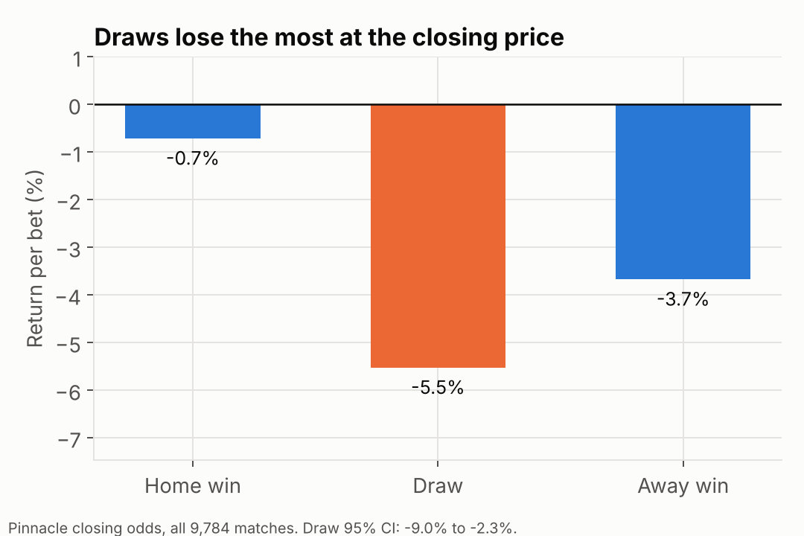

# Are soccer betting odds calibrated?

A test of whether Pinnacle's closing odds on English soccer are calibrated, whether they show a
favourite–longshot bias, and whether any pattern survives out of sample as a betting edge.

**Data:** 9,784 Premier League and Championship matches, 2015/16–2025/26, from
[football-data.co.uk](https://www.football-data.co.uk).

## Findings

1. **The closing line is well calibrated.** With Shin margin removal, every probability band
   matches observed frequencies within its 95% bootstrap interval.
2. **Little evidence of a favourite–longshot bias.** Recalibration slope b = 1.015
   (95% CI 0.968–1.064) with Shin; 1.042 (0.988–1.093) with proportional margin removal.
   The apparent bias is largely an artefact of how the margin is removed.
3. **Draws look slightly overpriced.** Priced at 25.9%, occurred 25.4%. Flat-betting draws at
   the close returns −5.5% (CI −9.0% to −2.3%) vs −0.7% for home wins; consistent across both
   halves of the sample and both leagues, but the draw–home difference is not quite significant.
4. **Closing beats opening** on log loss (information arrives before kickoff). Bet365 is as
   accurate as Pinnacle at the open but charges a 5.1% margin vs 2.7%.
5. **No reliable profit out of sample** (2021/22–2025/26). The best variant's interval just
   touches zero and it was one of nine tried.




## Method

- Each match = three forecasts (H/D/A). Margin removed two ways: proportional, and Shin (1993).
- Calibration by probability band; all intervals bootstrap whole matches (1,000 resamples),
  since a match's three probabilities are dependent.
- Favourite–longshot bias = slope b in P(outcome) = σ(a + b·logit(p)), fit by maximum likelihood.
- Corrections learned on 2015/16–2020/21, evaluated only on 2021/22–2025/26.
- Betting tests use timing-consistent prices only (closing→closing, opening→opening), flat stakes.

## Run it

```
python src/analysis.py   # writes results/
python src/figures.py    # writes figures/
```

Needs numpy, pandas, scipy, matplotlib. Put the football-data CSVs in `data/` named
`E0_1516.csv`, `E1_1516.csv`, etc.

## Files

- `src/load.py` – reads and standardises the CSVs
- `src/devig.py` – proportional and Shin margin removal
- `src/analysis.py` – calibration, bias regression, returns, out-of-sample tests
- `src/figures.py` – charts
- `src/edge_search.py` – pre-registered edge tests (train 2015–21, test 2021–26)
- `results/` – all numbers (results.json + CSV tables)
