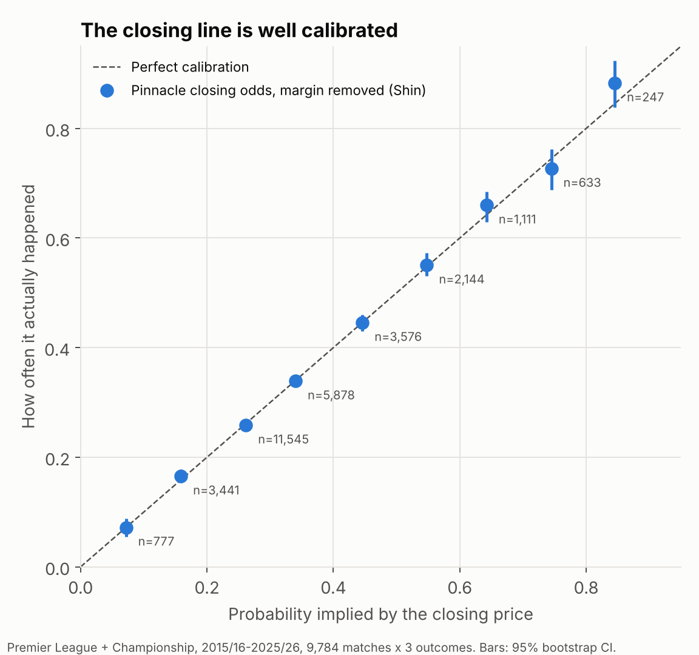
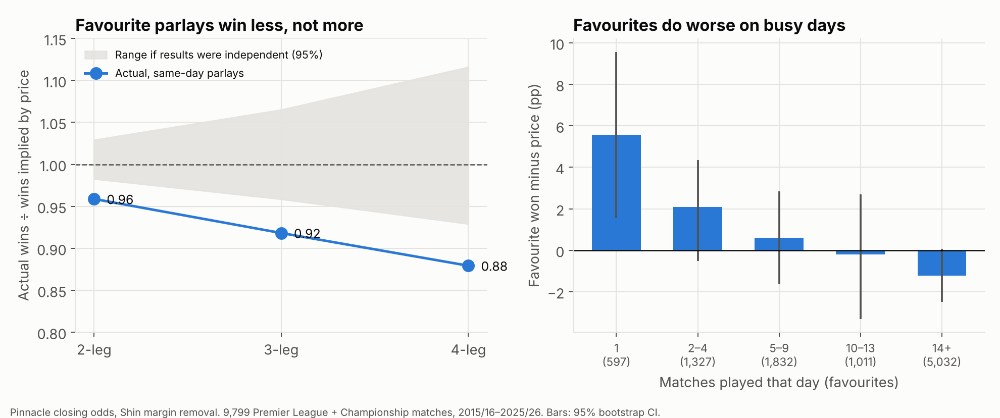
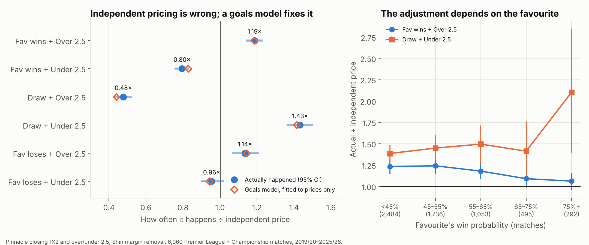

# Are soccer betting odds calibrated?

A test of whether Pinnacle's closing odds on English soccer are calibrated, whether they show a
favourite–longshot bias, and whether any pattern survives out of sample as a betting edge.

**Data:** 9,784 Premier League and Championship matches, 2015/16–2025/26, from
[football-data.co.uk](https://www.football-data.co.uk).

## Findings

1. **The closing line is well calibrated.** With Shin margin removal, every probability band
   matches observed frequencies within its 95% bootstrap interval.
2. **Little evidence of a favourite–longshot bias.** Recalibration slope b = 1.015
   (95% CI 0.968–1.064) with Shin; 1.042 (0.988–1.093) with proportional margin removal.
   The apparent bias is largely an artefact of how the margin is removed.
3. **Draws look slightly overpriced.** Priced at 25.9%, occurred 25.4%. Flat-betting draws at
   the close returns −5.5% (CI −9.0% to −2.3%) vs −0.7% for home wins; consistent across both
   halves of the sample and both leagues, but the draw–home difference is not quite significant.
4. **Closing beats opening** on log loss (information arrives before kickoff). Bet365 is as
   accurate as Pinnacle at the open but charges a 5.1% margin vs 2.7%.
5. **Bet365 follows Pinnacle about 90% of the way.** Between open and close, Bet365's price moves
   0.90 as far as Pinnacle's (95% CI 0.88–0.91). The closing line shows no over- or under-reaction
   to pre-match moves. Bet365's margin is larger than its lag, so this is not bettable.
6. **No reliable profit out of sample** (2021/22–2025/26). The best variant's interval just
   touches zero and it was one of nine tried.




## Follow-up: do favourites win together?

Prompted by NFL Week 9, when combo market makers lost heavily as favourites hit together.
If same-day results are correlated, a parlay priced as independent legs is underpriced.

**Test:** favourite = highest fair probability per match (Pinnacle close, Shin). For every set of
2, 3 or 4 favourites playing on the same day, compare actual all-win count with the sum of the
products of their prices. Null: shuffle dates within each season, 2,000 times.

**Result (English soccer, 9,799 matches):** no sign that favourites win together.
- Results are essentially uncorrelated within a day (average correlation −0.002; overdispersion 0.97, p = 0.74).
- Same-day favourite parlays actually won *less* than independent pricing implies:
  2-leg 0.96×, 3-leg 0.92×, 4-leg 0.88× (all below the 95% null range).
- That is not correlation. Favourites slightly underperform on busy days (14+ matches: −1.2pp)
  and outperform on quiet days (single-match days: +5.6pp), and most same-day parlays come from
  busy Saturdays. The quiet-vs-busy gap (+3.0pp, 95% CI 1.1 to 4.9) points the same way in both
  halves of the sample and both leagues, but I found it after the main test, so treat it as a lead.

**Limits:** English 1X2 favourites only, closing prices, cross-game parlays (not same-game parlays,
where legs are correlated by construction).



## Follow-up: same-game parlays (result × over/under 2.5)

**Question:** for a same-game parlay combining the match result with over/under 2.5 goals, how far
off is pricing the legs as independent (multiplying the two fair prices)? And does a simple goals
model, fitted only to the market's own single-market prices, get the combination right?

**Data:** Pinnacle closing 1X2 and over/under 2.5, Shin margin removal, 6,060 Premier League +
Championship matches, 2019/20 to 2025/26 (over/under closing odds start in 2019/20).

**Goals model:** per match, independent Poisson goals for each team, with rates chosen so the model
reproduces the market's fair 1X2 and over 2.5 prices. It never sees results.

**Result: independent pricing is badly wrong; the goals model gets it right.**

| Combo | Happens vs independent price | Goals model vs independent |
|---|---|---|
| Favourite wins + over 2.5 | **1.19×** (95% CI 1.14–1.23) | 1.19× |
| Favourite wins + under 2.5 | 0.80× (0.75–0.83) | 0.83× |
| Draw + over 2.5 | 0.48× (0.43–0.52) | 0.44× |
| Draw + under 2.5 | **1.43×** (1.36–1.50) | 1.41× |
| Favourite loses + over 2.5 | 1.14× (1.07–1.21) | 1.14× |
| Favourite loses + under 2.5 | 0.96× (0.90–1.02) | 0.94× |

- Pricing as independent would sell "favourite wins + over 2.5" about 16% too cheap, and
  "draw + under 2.5" about 30% too cheap.
- The Poisson model's combo prices match what actually happened within its confidence intervals for
  every combo, and it beats independence on log loss for the joint outcome (−0.045, 95% CI −0.053 to −0.038).
- The adjustment depends on the favourite: "favourite wins + over" shrinks from 1.23× for near-even
  matches to 1.06× for 75%+ favourites, while "draw + under" grows.
- Known gap: plain Poisson prices draws about 6% lower than the market does. A Dixon–Coles
  low-score adjustment is the natural next step.



## Method

- Each match = three forecasts (H/D/A). Margin removed two ways: proportional, and Shin (1993).
- Calibration by probability band; all intervals bootstrap whole matches (1,000 resamples),
  since a match's three probabilities are dependent.
- Favourite–longshot bias = slope b in P(outcome) = σ(a + b·logit(p)), fit by maximum likelihood.
- Corrections learned on 2015/16–2020/21, evaluated only on 2021/22–2025/26.
- Betting tests use timing-consistent prices only (closing→closing, opening→opening), flat stakes.

## Run it

```
python src/analysis.py   # writes results/
python src/figures.py    # writes figures/
```

Needs numpy, pandas, scipy, matplotlib. Put the football-data CSVs in `data/` named
`E0_1516.csv`, `E1_1516.csv`, etc.

## Files

- `src/load.py` – reads and standardises the CSVs
- `src/devig.py` – proportional and Shin margin removal
- `src/analysis.py` – calibration, bias regression, returns, out-of-sample tests
- `src/figures.py` – charts
- `src/line_moves.py` – opening-to-closing price moves, and how Bet365 follows Pinnacle
- `src/favourites_together.py` – do same-day favourites win together? (parlay correlation test)
- `src/same_game.py` – same-game parlay correlation and Poisson goals model
- `src/edge_search.py` – pre-registered edge tests (train 2015–21, test 2021–26)
- `results/` – all numbers (results.json + CSV tables)
