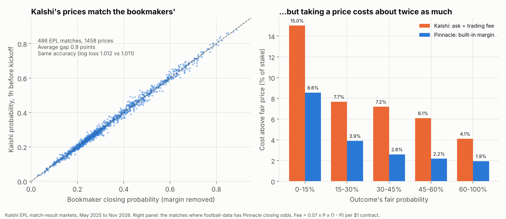
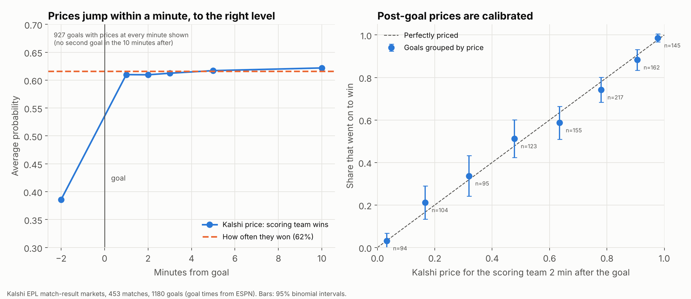
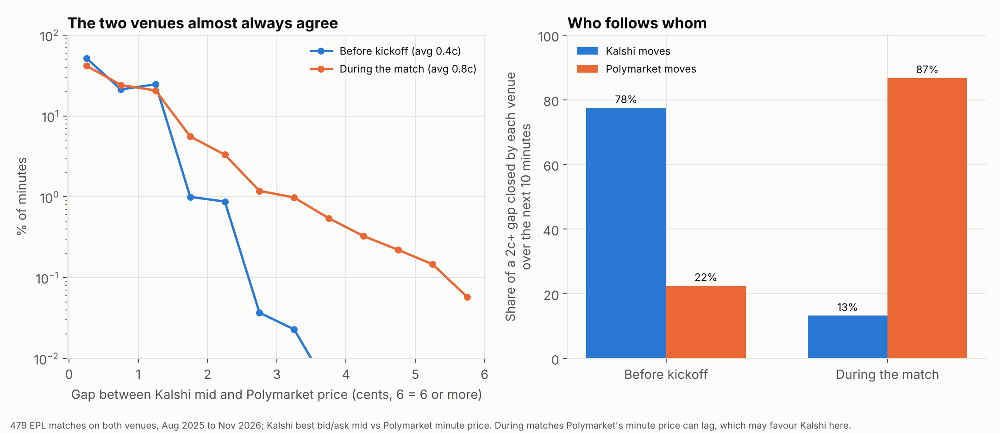
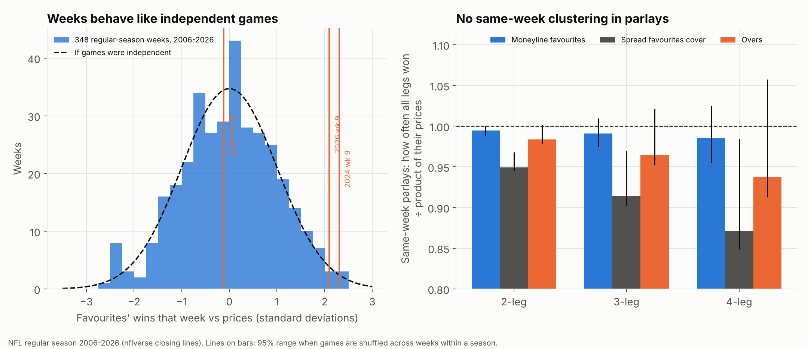
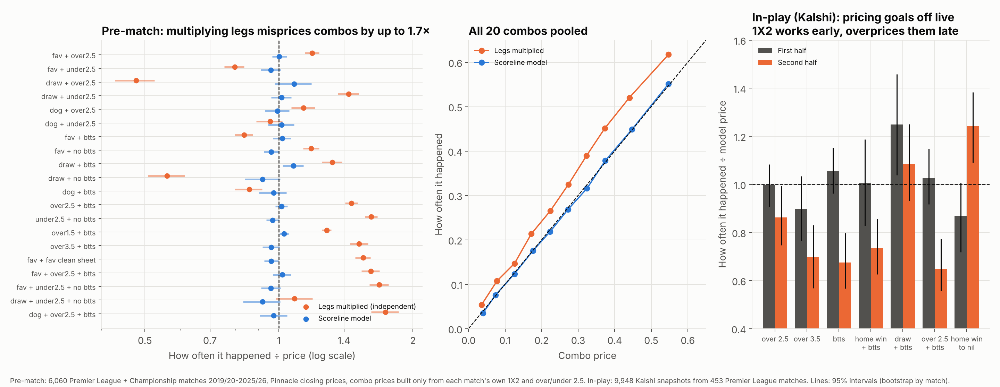

# Are soccer betting odds calibrated?

A test of whether Pinnacle's closing odds on English soccer are calibrated, whether they show a
favourite–longshot bias, and whether any pattern survives out of sample as a betting edge.

**Data:** 9,784 Premier League and Championship matches, 2015/16–2025/26, from
[football-data.co.uk](https://www.football-data.co.uk).

## Findings

1. **The closing line is well calibrated.** With Shin margin removal, every probability band
   matches observed frequencies within its 95% bootstrap interval.
2. **Little evidence of a favourite–longshot bias.** Recalibration slope b = 1.015
   (95% CI 0.968–1.064) with Shin; 1.042 (0.988–1.093) with proportional margin removal.
   The apparent bias is largely an artefact of how the margin is removed.
3. **Draws look slightly overpriced.** Priced at 25.9%, occurred 25.4%. Flat-betting draws at
   the close returns −5.5% (CI −9.0% to −2.3%) vs −0.7% for home wins; consistent across both
   halves of the sample and both leagues, but the draw–home difference is not quite significant.
4. **Closing beats opening** on log loss (information arrives before kickoff). Bet365 is as
   accurate as Pinnacle at the open but charges a 5.1% margin vs 2.7%.
5. **Bet365 follows Pinnacle about 90% of the way.** Between open and close, Bet365's price moves
   0.90 as far as Pinnacle's (95% CI 0.88–0.91). The closing line shows no over- or under-reaction
   to pre-match moves. Bet365's margin is larger than its lag, so this is not bettable.
6. **No reliable profit out of sample** (2021/22–2025/26). The best variant's interval just
   touches zero and it was one of nine tried.


## Follow-up: do favourites win together?

Prompted by NFL Week 9, when combo market makers lost heavily as favourites hit together.
If same-day results are correlated, a parlay priced as independent legs is underpriced.

**Test:** favourite = highest fair probability per match (Pinnacle close, Shin). For every set of
2, 3 or 4 favourites playing on the same day, compare actual all-win count with the sum of the
products of their prices. Null: shuffle dates within each season, 2,000 times.

**Result (English soccer, 9,799 matches):** no sign that favourites win together.
- Results are essentially uncorrelated within a day (average correlation −0.002; overdispersion 0.97, p = 0.74).
- Same-day favourite parlays actually won *less* than independent pricing implies:
  2-leg 0.96×, 3-leg 0.92×, 4-leg 0.88× (all below the 95% null range).
- That is not correlation. Favourites slightly underperform on busy days (14+ matches: −1.2pp)
  and outperform on quiet days (single-match days: +5.6pp), and most same-day parlays come from
  busy Saturdays. The quiet-vs-busy gap (+3.0pp, 95% CI 1.1 to 4.9) points the same way in both
  halves of the sample and both leagues, but I found it after the main test, so treat it as a lead.

**Limits:** English 1X2 favourites only, closing prices, cross-game parlays (not same-game parlays,
where legs are correlated by construction).


## Follow-up: same-game parlays (result × over/under 2.5)

**Question:** for a same-game parlay combining the match result with over/under 2.5 goals, how far
off is pricing the legs as independent (multiplying the two fair prices)? And does a simple goals
model, fitted only to the market's own single-market prices, get the combination right?

**Data:** Pinnacle closing 1X2 and over/under 2.5, Shin margin removal, 6,060 Premier League +
Championship matches, 2019/20 to 2025/26 (over/under closing odds start in 2019/20).

**Goals model:** per match, independent Poisson goals for each team, with rates chosen so the model
reproduces the market's fair 1X2 and over 2.5 prices. It never sees results.

**Result: independent pricing is badly wrong; the goals model gets it right.**

| Combo | Happens vs independent price | Goals model vs independent |
|---|---|---|
| Favourite wins + over 2.5 | **1.19×** (95% CI 1.14–1.23) | 1.19× |
| Favourite wins + under 2.5 | 0.80× (0.75–0.83) | 0.83× |
| Draw + over 2.5 | 0.48× (0.43–0.52) | 0.44× |
| Draw + under 2.5 | **1.43×** (1.36–1.50) | 1.41× |
| Favourite loses + over 2.5 | 1.14× (1.07–1.21) | 1.14× |
| Favourite loses + under 2.5 | 0.96× (0.90–1.02) | 0.94× |

- Pricing as independent would sell "favourite wins + over 2.5" about 16% too cheap, and
  "draw + under 2.5" about 30% too cheap.
- The Poisson model's combo prices match what actually happened within its confidence intervals for
  every combo, and it beats independence on log loss for the joint outcome (−0.045, 95% CI −0.053 to −0.038).
- The adjustment depends on the favourite: "favourite wins + over" shrinks from 1.23× for near-even
  matches to 1.06× for 75%+ favourites, while "draw + under" grows.
- Known gap: plain Poisson prices draws about 6% lower than the market does. A Dixon–Coles
  low-score adjustment is the natural next step (tested in the combo pricer section below: it does not help).


## Follow-up: is Kalshi's Premier League market as good as the bookmakers'?

**Question:** prediction markets are often described as less efficient than sharp bookmakers.
For Premier League match-result markets on Kalshi, are the prices less accurate, biased in any
direction, or more expensive to trade, compared with bookmaker closing odds?

**Data:** every settled Kalshi EPL match-result market from May 2025 to November 2026
(486 matches, 1,458 prices), plus Kalshi's over 2.5 goals market where it existed (377 matches).
Kalshi price = mid of the best bid and ask in the last hourly candle ending at least 1 hour before
kickoff (spread 5 cents or less), rescaled so the three outcomes sum to 1. Benchmark = Pinnacle
closing odds where football-data has them (217 matches), otherwise the market-average closing odds,
with Shin margin removal. Median volume: about 360,000 contracts per match in the last day.

**Result: the prices are the same; the cost of taking them is not.**

- **Same prices.** Kalshi's probabilities sit on top of the bookmakers' (average gap 0.9
  percentage points; 11% of prices differ by more than 2 points). Over 2.5 goals: Kalshi 55.6%,
  bookmakers 55.6%.
- **Same accuracy.** Log loss 1.012 (Kalshi) vs 1.011 (bookmakers); difference +0.001
  (95% CI −0.002 to +0.004). Over 2.5: difference +0.002 (CI −0.002 to +0.005).
- **No bias relative to the books.** Draws: Kalshi 24.4%, bookmakers 24.4% (both below the
  27.2% that happened in this sample, which is within noise). No favourite–longshot gap in any band.
- **Twice the cost to a taker.** Buying at Kalshi's ask and paying its standard fee
  (0.07 × P × (1 − P) per $1 contract) costs 7.6% above fair value on the matches with Pinnacle odds,
  against Pinnacle's 3.6% margin. About 80% of Kalshi's cost is the fee, not the spread
  (average spread 1.2 cents). The gap is widest on longshots: 15.0% vs 8.6% below 15% probability.
- **No free money.** Buying on Kalshi whenever its ask plus fee was below the bookmakers' fair
  price: 79 bets, return −9.7% (95% CI −40% to +20%). The apparent edges averaged under 1 cent.
- **Lead, not a finding:** using Kalshi's last pre-kickoff hour instead (which includes team news),
  Kalshi was slightly *more* accurate than Pinnacle's close (log loss −0.005, CI −0.009 to −0.001,
  217 matches). Exact timestamps of football-data's closing odds aren't known, so this may be timing.

**Limits:** one league; match-result and over 2.5 markets only; the fee assumes Kalshi's standard
schedule (series-specific or maker rates may differ); a bettor posting limit orders instead of
taking the ask pays less. Same-game combos could not be studied: each combo is a one-off market,
there are thousands an hour across all sports, and the API offers no way to find those on a given match.



## Follow-up: how does Kalshi's in-play market react to goals?

**Question:** after a goal, are Kalshi's prices right on average, or do they over- or under-react?
How fast do they move? And are draws priced fairly late in level games?

**Data:** Kalshi's minute-by-minute best bid and ask for each Premier League match-result market,
from kickoff to full time, for 453 matches (May 2025 to November 2026). Goal and red-card times
come from ESPN's public match data; every final score matches football-data. Each goal is placed
on the price path at the biggest move toward the scoring team just after the match-clock time.
1,180 goals in total.

**Test:** a fair price is a probability. So across many goals, the scoring team's price a few minutes
after the goal should equal how often that team went on to win. Intervals bootstrap whole matches.

**Result: no over- or under-reaction.**

- **Fast.** About 99% of the price move after a goal happens within the first minute.
- **Right level.** Two minutes after a goal, Kalshi priced the scoring team at 60.8% on average;
  they won 60.1% of the time (gap +0.7 points, 95% CI −1.9 to +3.4). The same holds at 1, 5 and
  10 minutes. Calibration slope 0.90 (CI 0.80–1.03), so no clear sign of prices being too extreme.
- **Late leads are priced right.** From the 70th minute, a team leading by one was priced at 81.0%
  and won 80.4% of the time.
- **Lead, not a finding: draws may be slightly cheap in-play.** After an equaliser, the draw was priced
  at 49.3% and happened 54.6% of the time (CI for the gap −11.5 to +1.4 points); in level games from
  the 70th minute, 67.8% vs 71.9% (CI −10.2 to +1.8). Neither is significant, but they point the same
  way as the pre-match result above, where draws also happened more often than priced.
- Early in matches, prices look slightly too confident (slope 0.74 in the first 30 minutes), but the
  bookmakers' pre-match prices for the same matches show the same (0.89 vs Kalshi 0.88), so this
  looks like a quirk of this sample of matches, not of Kalshi's in-play market.

**Limits:** one league; Kalshi's quotes only (not its traded prices); a minute is the finest resolution,
so reactions inside the first minute can't be seen; 32 matches were dropped because a goal couldn't
be located on the price path.



## Follow-up: Kalshi vs Polymarket on the same matches (cross-venue arbitrage)

**Question:** Kalshi and Polymarket both list Premier League match results. Do their prices ever
drift far enough apart that buying YES on one and NO on the other locks in a profit after fees?
And when they disagree, which venue moves to close the gap?

**Data:** 479 EPL matches listed on both venues (Aug 2025 to Nov 2026), minute by minute from
3 hours before kickoff to the end of the match: Kalshi's best bid and ask, and Polymarket's minute
price history. Plus a live snapshot of both order books for the next 10 matches (17 Nov 2026).

**How a lock-in works:** one of "YES on venue A" and "NO on venue B" always pays $1, so if both cost
less than $1 together, including Kalshi's fee (0.07 × P × (1 − P)) and Polymarket's sports fee
(0.05 × P × (1 − P)), the profit is locked in. With prices near 50 cents the fees alone are about
3 cents, so the venues need to disagree by roughly 3–4 cents before anything is left.

**Result: before kickoff the two venues are effectively one market.**

- **Before kickoff they agree to within half a cent on average.** Gaps over 2 cents happen in 0.9%
  of minutes and never reach 5 cents. After fees there was essentially no lock-in (2 matches,
  under 0.2 cents).
- **The live order books agree too.** On 17 Nov, 17 of 30 outcomes had the identical best ask on both
  venues; the best available lock-in for 100 contracts *lost* 1.6 cents (average −2.9 cents).
- **When they disagree before kickoff, Kalshi does most of the moving:** about 78% of a 2-cent gap is
  closed by Kalshi's price over the next 10 minutes, so Polymarket's price looks like the one that
  holds.
- **Equally accurate.** At five minutes before kickoff, log loss 1.011 (Kalshi) vs 1.013 (Polymarket),
  difference not significant.
- **During matches, apparent lock-ins show up** in about 2% of minutes, averaging 5 cents. But 83%
  last a single minute and 39% sit right around a goal (against 11% of in-play minutes overall).
  That is what stale prices look like: Polymarket's history gives one price per minute, not a live
  quote, so in fast moments it can lag what was really tradeable. They can't be counted as real
  opportunities without tick-level order-book data. The same staleness is probably why Polymarket
  appears to "follow" Kalshi during matches (87% of gaps closed by Polymarket).

**Limits:** Polymarket quotes are approximated as its minute price ± 0.25–1 cent; one league; fees
assume the published taker schedules; settlement rules must match for a lock-in to be real (both
settle on 90 minutes plus stoppage time for these markets).

**Live scanner:** `src/xvenue_scanner.py` polls both order books every 20 seconds for upcoming EPL
matches, prices each lock-in at a real size (walking the book for 100 contracts), logs every check
to `results/xvenue_scan_log.csv`, and records paper trades. It never places orders. The snapshot
above was produced with the same logic.



## Follow-up: do NFL favourites win together in the same week?

**Question:** in NFL weeks 9 and 10 of 2026, parlay market makers lost heavily as favourites came in.
A loss like that is usually called rare by simulating each game independently. That is only right if
favourites don't tend to win (or lose) together in the same week. Do they?

**Data:** every NFL regular-season game 2006–2026 with closing lines from the public nflverse game file
(5,200 games with moneylines, 348 weeks). Same method as the soccer test above: compare same-week
outcomes with their prices, and build the null by shuffling games across weeks within each season.

**Result: NFL weeks behave like independent games, so independence-based rarity estimates hold up.**

- **Prices are right on average.** Moneyline favourites won 66.5% of the time, priced at 66.7%.
- **No same-week clustering.** Average within-week correlation of favourites' results +0.002
  (null range −0.008 to +0.012); same-week 2-, 3- and 4-leg favourite parlays won 0.99× their price.
  Week-to-week swings are the size independent games would produce (standard deviation 1.02, vs 1.00).
  The same holds for spread favourites covering and for overs.
- **Favourites and overs are unrelated week to week** (correlation 0.00), so a book long both
  isn't doubly exposed through some common factor.
- **2026 week 9 really was extreme.** Favourites won 14 of 15 against 10.3 expected: only 3 weeks since
  2006 were better for favourites, one of them 2024 week 9 (the quarter the US sportsbooks warned
  investors about). If games are independent, 14 or more happens about 1 time in 39.
- **2026 week 10 was ordinary for straight-up favourites** (9 of 14 won, 9.2 expected), and overs went
  9 of 14. So week 10's losses must come from which games were most heavily backed, not from the
  favourites as a group.

**Limits:** these are unweighted counts across all games; a market maker's loss depends on how much
was bet on each leg, which only the venues see. Closing lines come from nflverse's sources, not Kalshi.



## Follow-up: a combo (same-game parlay) pricer, tested pre-match and in-play

**Question:** event-market makers quote same-game combos ("favourite wins + over 2.5 + both teams
score") on request. Can a maker build correct combo prices from the single-market prices alone, and
how wrong is the shortcut of multiplying the legs as if they were independent?

**Pricer** (`src/combo_pricer.py`): turns a match's fair 1X2 and over/under 2.5 prices into a full
grid of final-score probabilities, then prices any combination of legs from that grid (result,
totals 0.5–4.5, both teams to score, clean sheets, correct score). Three scoreline models: plain
Poisson (2 parameters), Dixon–Coles and a both-teams-score tilt (3 parameters, matching all four
market prices exactly). No parameter is learned from results. In-play, it refits the rate of the
goals still to come from the live 1X2 price at the current score.

**Pre-match test:** 6,060 Premier League + Championship matches, 2019/20–2025/26, Pinnacle closing
prices (Shin margin removal), 20 combos of two or three legs.

**Result 1: multiplying legs is badly wrong; the scoreline model is right to within a few percent.**

| Combo (fav = 1X2 favourite) | Happened | Legs multiplied | Model | Happened ÷ multiplied | Happened ÷ model |
|---|---|---|---|---|---|
| Fav wins + over 2.5 | 30.9% | 26.0% | 30.8% | **1.19×** (1.14–1.23) | 1.00× (0.97–1.04) |
| Draw + over 2.5 | 6.0% | 12.6% | 5.6% | **0.48×** (0.43–0.53) | 1.08× (0.98–1.18) |
| Draw + under 2.5 | 18.9% | 13.2% | 18.7% | 1.43× (1.36–1.51) | 1.01× (0.96–1.07) |
| Fav wins + both score | 22.4% | 26.8% | 22.0% | 0.83× (0.80–0.87) | 1.02× (0.97–1.07) |
| Over 2.5 + both score | 39.4% | 27.1% | 38.9% | 1.45× (1.41–1.50) | 1.01× (0.98–1.04) |
| Fav wins to nil | 28.0% | 18.1% | 29.1% | 1.55× (1.48–1.61) | 0.96× (0.93–1.00) |
| Fav wins + over 2.5 + both score | 22.4% | 13.9% | 22.0% | **1.61×** (1.53–1.68) | 1.02× (0.97–1.06) |
| Underdog wins + over 2.5 + both score | 11.0% | 6.3% | 11.3% | **1.73×** (1.61–1.86) | 0.97× (0.91–1.04) |

- Across all 20 combos, multiplying legs misprices by 33% on average (mean absolute log ratio);
  the Poisson model by 3.6%.
- Correlation runs both ways: some combos happen far more often than multiplied legs imply (three-leg
  "win + goals" combos up to 1.7×), others far less (draw + over 2.5 at half). A maker using the
  shortcut would be picked off on one side and overcharge on the other.
- The three scoreline models price combos about equally well. Plain Poisson is marginally best
  (mean mispricing 3.6% vs 4.1% for Dixon–Coles and the tilt); forcing the grid to match the market's
  draw price exactly does not help, because the market's draw price itself runs slightly high (25.8%
  priced, 25.0% happened). The textbook Dixon–Coles correction adds nothing once the model is fitted
  to market prices rather than to past results.
- Remaining model misses are small and point the same way: draws with goals are slightly
  underpriced (draw + both score 1.08×, 1.02–1.14), 0-0 slightly overpriced (0.92×). Both have grown
  in the last three seasons (draw + over 2.5: 1.19× in 2023/24–2025/26).

**In-play test:** 9,948 Kalshi snapshots (every 5 minutes from kick-off) from 453 Premier League
matches. At each one the pricer reads only Kalshi's live 1X2 and the score.

**Result 2: the right combo price depends heavily on the score, and pricing goals off live 1X2
breaks down late in matches.**

- Correlation flips with the score. "Home win + over 2.5", relative to its legs multiplied: 1.24×
  at 0-0, **2.0× at 0-1** (the home side must score at least twice, which also sends the total
  over), 1.46× at 1-1, but 0.97× at 1-0 (the two legs are now nearly unrelated). A fixed
  correlation adjustment would be wrong most of the time.
- First half: totals and both-score prices derived from live 1X2 are right (over 2.5 1.00×,
  0.91–1.08; both score 1.06×, 0.96–1.15).
- Second half: the same method overprices goals by 14–35% (over 3.5 0.70×, 0.57–0.83; both score
  0.67×, 0.57–0.80) and underprices "win to nil" (1.24×, 1.09–1.38). Kalshi's live draw price is
  only slightly cheap here (1.08×, 0.95–1.19), so most of the error is the model's assumption that
  late goals arrive independently of the score: a leading team protects its lead. A maker should
  price late-match totals from a totals market or a score-dependent goal model, not back them out
  of the 1X2.



**Limits:** pre-match prices are Pinnacle closing only (no market prices for both-teams-score, so
those legs are model-priced on both sides of the comparison); no real combo quotes from Kalshi's RFQ
flow to compare against (the public API does not list combos by match); in-play sample is one and a
half seasons of Premier League, with a high draw rate (27%).

## Method

- Each match = three forecasts (H/D/A). Margin removed two ways: proportional, and Shin (1993).
- Calibration by probability band; all intervals bootstrap whole matches (1,000 resamples),
  since a match's three probabilities are dependent.
- Favourite–longshot bias = slope b in P(outcome) = σ(a + b·logit(p)), fit by maximum likelihood.
- Corrections learned on 2015/16–2020/21, evaluated only on 2021/22–2025/26.
- Betting tests use timing-consistent prices only (closing→closing, opening→opening), flat stakes.

## Run it

```
python src/analysis.py   # writes results/
python src/figures.py    # writes figures/
python src/kalshi_vs_books.py   # Kalshi comparison (data in data/kalshi/)
python src/kalshi_inplay.py     # Kalshi in-play reactions to goals
python src/xvenue_study.py      # Kalshi vs Polymarket gaps and lock-ins
python src/xvenue_scanner.py    # live paper-trading scanner (Ctrl+C to stop)
python src/nfl_weeks.py         # NFL same-week correlation (data/nfl/games.csv from nflverse)
python src/combo_study.py       # combo pricer, pre-match test (~2 min)
python src/combo_inplay.py      # combo pricer, in-play test on Kalshi
```

Needs numpy, pandas, scipy, matplotlib. Put the football-data CSVs in `data/` named
`E0_1516.csv`, `E1_1516.csv`, etc.

## Files

- `src/load.py` – reads and standardises the CSVs
- `src/devig.py` – proportional and Shin margin removal
- `src/analysis.py` – calibration, bias regression, returns, out-of-sample tests
- `src/figures.py` – charts
- `src/line_moves.py` – opening-to-closing price moves, and how Bet365 follows Pinnacle
- `src/favourites_together.py` – do same-day favourites win together? (parlay correlation test)
- `src/same_game.py` – same-game parlay correlation and Poisson goals model
- `src/kalshi_fetch.py` – downloads Kalshi EPL prices around kickoff (public API, no key)
- `src/kalshi_vs_books.py` – Kalshi vs bookmaker accuracy, bias, cost and a betting test
- `src/kalshi_inplay.py` – Kalshi in-play prices around goals, late-game draws
- `src/xvenue_study.py` – Kalshi vs Polymarket price gaps, fee-adjusted lock-ins, who follows whom
- `src/xvenue_scanner.py` – live scanner for cross-venue lock-ins (paper trading only)
- `data/xvenue/` – matched Kalshi/Polymarket minute prices and the 17 Nov live snapshot
- `src/nfl_weeks.py` – do NFL favourites, covers and overs cluster within a week?
- `src/combo_pricer.py` – combo / same-game parlay pricer (scoreline grid from 1X2 + totals, pre-match and in-play)
- `src/combo_study.py` – pre-match test of the pricer on 6,060 matches
- `src/combo_inplay.py` – in-play test of the pricer on Kalshi
- `data/nfl/games.csv` – nflverse game file (github.com/nflverse/nfldata), 2006–2026
- `data/kalshi/` – the Kalshi prices used (collected 16–17 Nov 2026) and ESPN goal times
- `src/edge_search.py` – pre-registered edge tests (train 2015–21, test 2021–26)
- `results/` – all numbers (results.json + CSV tables)
